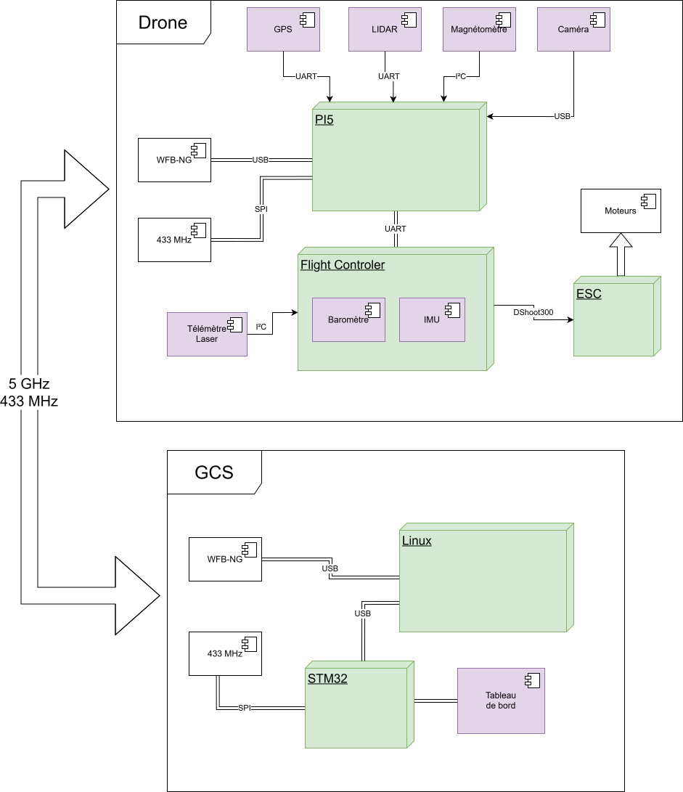

# Matériel — vue d'ensemble système

Documentation matérielle du drone : les sous-systèmes physiques, leur
interface électrique/protocole, et leur point d'intégration côté logiciel
(fichier driver, composant qui les consomme). Complète le `README.md`
(logiciel) — ici, l'angle est "qu'est-ce qui est monté sur le drone et
comment ça parle au reste du système".

Illustrations : vues CAO (SolidWorks) et schémas (draw.io) déposés dans
`docs/img/`, référencés sous chaque section — absents tant qu'ils n'ont
pas été exportés. **Convention pour un tracé** (schéma/plan en lignes, pas
un rendu coloré) : un seul SVG déposé (couleur de trait = noir, pour fond
clair) ; je dérive moi-même une variante fond sombre (traits blancs) et
câble les deux via `<picture>`/`prefers-color-scheme` pour que le tracé
suive automatiquement le thème clair/sombre du lecteur (GitHub et la
plupart des visionneuses Markdown le supportent). Les rendus
photoréalistes (captures SolidWorks ombrées) restent une seule image, pas
de bascule.

## 1. Vue d'ensemble

## 2. Radio / communication

Deux liens de télémétrie, dimensionnés en primaire/secours :

- **Primaire — wfb-ng, 433MHz** (`WFB_NG_Driver`,
  `include/drone/Components/SystemMonitoring/Driver/WFB_NG_Driver.hpp`) :
  wifi broadcast longue portée, porte la télémétrie complète + la vidéo.
  **Squelette d'interface seulement — pas encore implémenté** (pas de
  `.cpp`, câblage hardware SPI/socket RF pas encore fait).
- **Secondaire — CC1101, sub-GHz SPI** (`CC1101_Driver.hpp`) : liaison de
  secours bas débit, ne porte que le sous-ensemble léger de
  `TELEMETRY.csv` (`Links=BOTH`). **Pas encore implémenté** non plus —
  script de banc `tools/hw_debug/CC1101_test.py` (SPI bus 0/CE0, 500kHz,
  mode 0) confirme l'interface mais pas de driver de prod.
- **Côté GCS** : adaptateur WiFi RTL8812AU dédié (DKMS
  `svpcom/rtl8812au` v5.2.20) prévu pour recevoir wfb-ng, séparé du WiFi
  générique de la malette (cf. `GCS/README.md` §5.2) — matériel présent
  mais pas encore le chemin logiciel principal actif.

<picture>
  <source media="(prefers-color-scheme: dark)" srcset="docs/img/radio-antennes-dark.svg">
  
</picture>

**Antenne** : omnidirectionnelle, montée sur le dessus de la coque.

## 3. LIDAR

Deux capteurs de portée, rôles différents :

- **LD06** (360°, évitement d'obstacle horizontal) — `src/Drivers/LD06.cpp`,
  UART `/dev/ttyAMA2` par défaut, 230400 bauds, protocole LDROBOT LD06/LD19
  (paquets 47 octets, CRC8 poly `0x4D`, 12 points/paquet). **Monté sous le
  nez, devant la batterie**, champ ~200° (non mesuré précisément — cf.
  `NAVIGATION.md` §6, angle mort à l'arrière, la détection d'obstacle
  suppose que le nez pointe à peu près dans le sens de déplacement).
- **TF Luna** (portée verticale unique, rangefinder) — câblé sur le **FC**,
  pas sur le Pi (`DISTANCE_SENSOR` MAVLink, orientation `RNGFND1_ORIENT=25`
  = vers le bas, portée 0.2–8m). Pas de driver C++ Pi puisqu'il ne parle
  jamais directement au Pi.

<table><tr>
<td width="50%">

<picture>
  <source media="(prefers-color-scheme: dark)" srcset="docs/img/lidar-fov-dark.svg">
  
</picture>

</td>
<td width="50%">

<picture>
  <source media="(prefers-color-scheme: dark)" srcset="docs/img/lidar-sensors-dark.svg">
  
</picture>

</td>
</tr></table>

**TF Luna** : monté à l'avant gauche, à l'intérieur de la coque, orienté
vers le bas, parallèle au châssis.

## 4. Centrale inertielle et magnétomètre

Les deux capteurs sont **montés sur le PCB du FC lui-même**, pas sur le
Pi — aucun driver Pi-side ni bus I2C/SPI dédié à monitorer côté logiciel
de vol pour ces deux capteurs, tout arrive via MAVLink depuis le FC.

- **MPU6050** (IMU accéléro+gyro) — puce du FC (Sequre), jamais
  exposée directement au Pi. L'attitude utilisée par le logiciel de vol
  vient exclusivement du FC via MAVLink (`SharedFCStatus`/
  `SENSORFUSION.md` §4) — cohérent, ce n'est pas un capteur séparé à
  câbler.
- **LIS3MDL** (magnétomètre) — un driver Pi existe dans le repo
  (`include/drone/Components/Drivers/LIS3MDL.hpp`, I2C, adresse `0x1C`,
  bus `/dev/i2c-1`, registres figés "NE PAS MODIFIER") mais **n'est plus
  câblé sur le Pi** : décision actée de le câbler directement sur le FC
  (`SENSORFUSION.md` §3.5) pour la santé de l'EKF3 — `GPS_INPUT.yaw` part
  à 0 en permanence côté logiciel, le FC utilise son propre compas. Le
  fichier driver n'a pas été supprimé (pourrait resservir si un
  magnétomètre externe est un jour remonté côté Pi).

<picture>
  <source media="(prefers-color-scheme: dark)" srcset="docs/img/imu-magneto-dark.svg">
  
</picture>

## 5. GPS — NEO-M8N

`src/Drivers/NEO-M8N.cpp`, UART `/dev/ttyAMA1` par défaut. Démarre
toujours à 9600 bauds (défaut du module, pas persisté en EEPROM), le
driver envoie une trame UBX-CFG-PRT figée pour basculer à 115200 puis
rouvre le port. Parseur binaire UBX (NAV-STATUS, NAV-PVT, NAV-DOP,
NAV-POSLLH, NAV-TIMEUTC, NAV-SAT).

<picture>
  <source media="(prefers-color-scheme: dark)" srcset="docs/img/gps-antenne-dark.svg">
  
</picture>

**Antenne** : patch intégrée, montée sur l'arrière-haut de la coque.

## 6. Caméra / vidéo

**Matériel** : caméra type barrette webcam de PC portable, branchée en
USB sur le Pi 5 (pas de module CSI officiel).

**Logiciel : pas encore fait.** L'interface existe côté architecture
(`IVideoSource::pollFrame()`, `WFB_NG_Driver` en implémentation réelle
pas codée, `UdpVideoDriver` en bouchon de dev qui reçoit du MJPEG déjà
encodé sur UDP loopback) mais **rien ne lit la caméra USB réelle
aujourd'hui** — il manque un driver `IVideoSource` concret qui capture
depuis `/dev/videoX` (V4L2) et encode les frames, à écrire avant de
pouvoir relier la caméra au pipeline `VideoTask`/`WFB_NG_Driver`
existant.

<picture>
  <source media="(prefers-color-scheme: dark)" srcset="docs/img/camera-dark.svg">
  
</picture>

## 7. Flight controller — Sequre

Sous ArduPilot, gère la stabilisation d'attitude et le contrôle moteur bas
niveau — le Pi 5 n'y touche jamais directement. Communication MAVLink v2
sur UART (`MavlinkInterface`, `UART` en prod / `UDP` en SITL, abstrait
derrière `IMavlinkLink`), **baudrate ~920000** (à confirmer précisément —
la valeur standard la plus proche est 921600). **Le port UART exact côté
Pi (`/dev/ttyAMAx`) n'est pas documenté dans le code** — contrairement au
GPS/LD06 qui ont un port par défaut explicite dans leur driver.

Pas d'illustration pour l'instant (seules des photos existent, pas
raccord avec le reste de la DA en tracé/rendu).

## 8. Motorisation, propulsion, batterie, châssis

- **Configuration** : quadricoptère, châssis 8 pouces, style FPV freestyle
  (FC + ESC en stack, composants FPV standards).
- **Hélices** : tripales 6045 (6" de diamètre, pas de 4.5").
- **Batterie** : pack LiPo **6S**, 4300mAh.
- **Moteurs** : iFlight XING-E Pro 2207, 1800KV, 2-6S.
- **ESC** : Flywoo GOKU G45M, 45A, firmware AM32, footprint 20x20mm.
- Télémétrie lue via MAVLink `ESC_STATUS`/`ESC_TELEMETRY_1_TO_4` (RPM,
  courant, température par moteur). Seuils RPM (`kMinArmedRpm=1000`,
  `kMaxArmedRpm=10000`) explicitement marqués "valeurs de départ
  arbitraires, à calibrer sur banc" — pas encore calées sur ce moteur
  précis (1800KV en 6S peut largement dépasser 10000 tr/min à pleine
  charge selon l'hélice, à vérifier avant calibration).

<picture>
  <source media="(prefers-color-scheme: dark)" srcset="docs/img/propulsion-chassis-dark.svg">
  
</picture>

## 9. Train d'atterrissage

Quatre jambes avec patins caoutchouc, imprimées en **PLA** (comme le
reste des pièces imprimées 3D du drone — coque, supports : choix
délibéré pour la flexibilité et le faible coût). Fixées au châssis par
4 vis traversantes + inserts filetés. **Double rôle** : sert aussi de
support batterie — la batterie est montée sur le ventre du drone, portée
par le même ensemble.

<picture>
  <source media="(prefers-color-scheme: dark)" srcset="docs/img/train-atterrissage-dark.svg">
  
</picture>

## 10. Station sol (GCS)

Détaillée dans `GCS/README.md` — résumé : PC (Node.js + dashboard
Chromium) + boîtier ESP32 dédié aux voyants d'alarme. Boîtier ESP32 :
2× MCP23017 (I2C, adresses `0x20`/`0x21`, 16 voyants chacune) + 4 GPIO
directs + 2 boutons physiques d'acquittement (câblage complet dans
`GCS/ESP32/mapingESP.csv`). Le nœud STM32 H562 initialement envisagé pour
la télémétrie secondaire a été **abandonné au profit de l'ESP32** déjà en
place — télémétrie toujours émulée en UDP loopback en attendant les liens
radio réels (§2).

Pas d'illustration pour l'instant (seules des photos existent, pas
raccord avec le reste de la DA en tracé/rendu).
