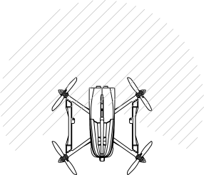

# OCAS — Obstacle Collision Avoidance System

Rôle : détection et évitement d'obstacle horizontal en temps réel, par
inhibition du guidage latéral quand un obstacle entre dans la zone de
sécurité devant le drone.

| | |
|---|---|
| **Composition matérielle** | LIDAR **LD06**, 360°, monté sous le nez, devant la batterie. Champ utile ~200° (non mesuré précisément), angle mort à l'arrière. |
| **Interface logicielle** | Driver `src/Drivers/LD06.cpp` (UART `/dev/ttyAMA2`, 230400 bauds, protocole LDROBOT LD06/LD19) → nuage de points publié dans `SharedSFMem::LidarMap` → consommé par `TFSTask` (`include/drone/Components/Navigation/Navigation.hpp`), le check de sécurité redondant de `Navigation`. |
| **Fonctionnement** | Zone de détection : boîte ~2×2 m devant le drone (`kObstacleBoxForwardM`/`kObstacleBoxLateralM`, `Conversions.hpp`), pas un cône — chaque point LIDAR est projeté sur les axes avant/latéral. Direction "avant" recalculée à partir de la vitesse réelle (`velNed`), pas du cap commandé. |
| **État actuel** | Driver LD06 implémenté (prod + variante SITL `UdpLidarDriver.cpp`). `TFSTask` implémenté dans `Navigation`, recalcule tout indépendamment de la loi de guidage (`TAP`) — aucune confiance dans un calcul déjà fait ailleurs. |
| **Redondance / sécurité** | Flag edge-triggered `obstacleActive_`, indépendant du check de fraîcheur EKF — les deux OR'és dans `holdActive_`. Angle mort arrière connu : la détection suppose que le nez pointe à peu près dans le sens de déplacement (marge ±50° avec le champ LIDAR). |

<table><tr>
<td width="50%">

<picture>
  <source media="(prefers-color-scheme: dark)" srcset="../img/lidar-fov-dark.svg">
  
</picture>

</td>
<td width="50%">

<picture>
  <source media="(prefers-color-scheme: dark)" srcset="../img/lidar-sensors-dark.svg">
  
</picture>

</td>
</tr></table>

Doc détaillée : `HARDWARE.md` §3, `include/drone/Components/Navigation/NAVIGATION.md` §6.
